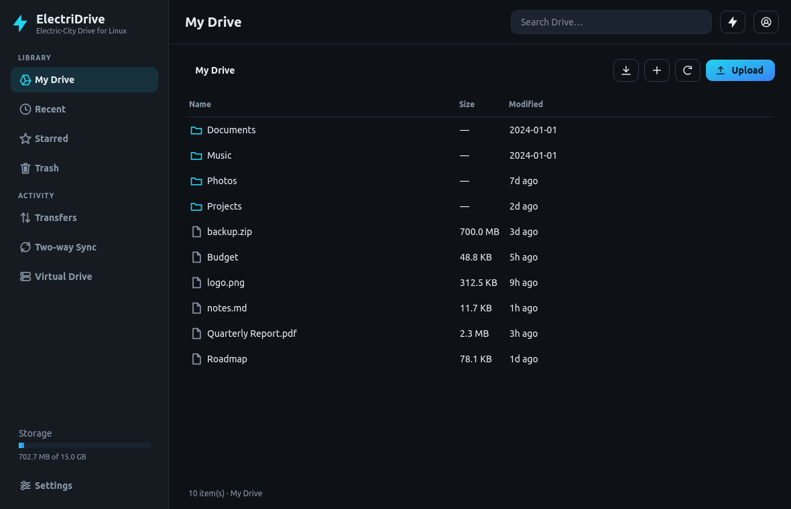
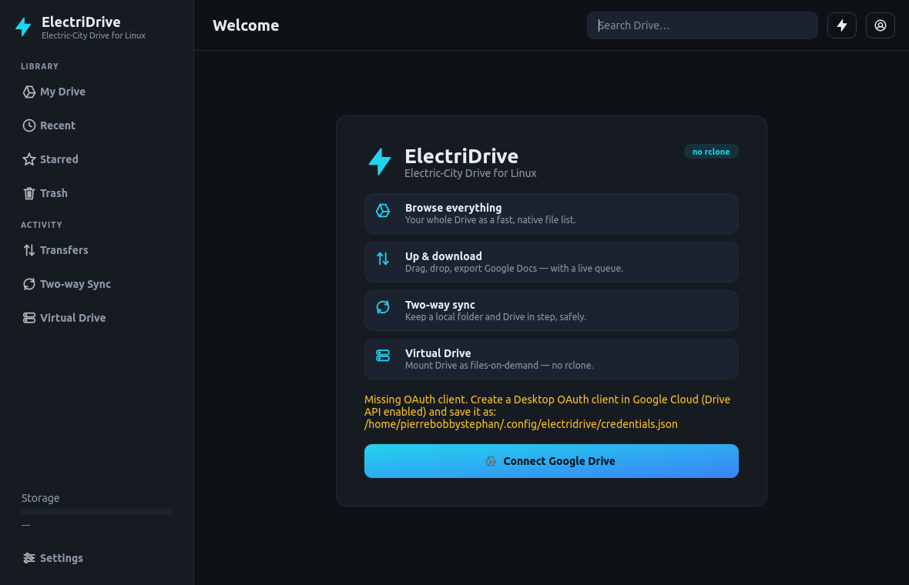
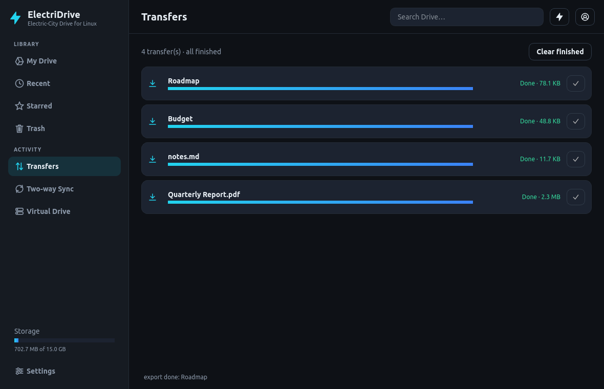
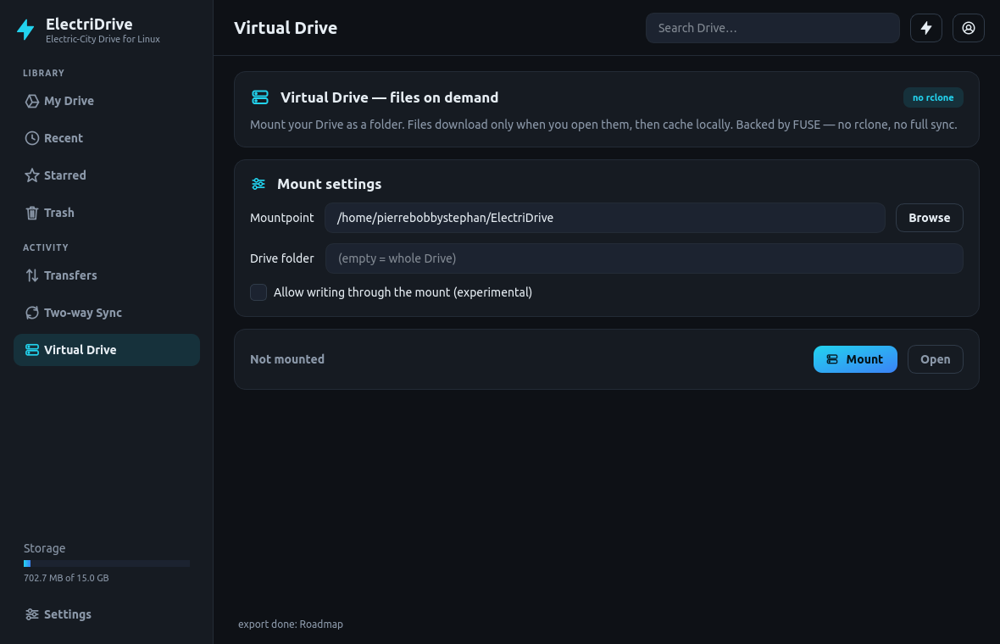

# ⚡ ElectriDrive — Electric-City Drive for Linux

[](https://github.com/ElectriCity-AI-Systems/electri-city-gdrive/releases/latest)
[](https://github.com/ElectriCity-AI-Systems/electri-city-gdrive/releases/latest)
[](https://github.com/ElectriCity-AI-Systems/electri-city-gdrive/releases/tag/v2.1.1)


**A beautiful, native, safety-first Google Drive client for Linux — browse, up/download,
two-way sync, and mount Drive as a virtual filesystem. Without rclone.**

ElectriDrive fills a gap that just opened up: GNOME 50 / Ubuntu 26.04 are **removing**
Google Drive from the file manager (the unmaintained `libgdata` integration), and the only
suggested replacements are command-line tools like rclone and `google-drive-ocamlfuse`.
ElectriDrive brings the experience back — with a modern Electric-Dark designer UI.

> ## ⬇️ Get ElectriDrive
> **Just want to use it? Download a ready-to-run build — no Python, no setup.**
> → **[Latest Debian release](https://github.com/ElectriCity-AI-Systems/electri-city-gdrive/releases/latest)**
> · **[Older AppImage (v2.1.1)](https://github.com/ElectriCity-AI-Systems/electri-city-gdrive/releases/tag/v2.1.1)**
> ```bash
> chmod +x ElectriDrive-x86_64.AppImage && ./ElectriDrive-x86_64.AppImage
> # …or:  sudo apt install ./electridrive_2.1.3_amd64.deb
> ```
> Running from source is only for developers — see [Install → Option B](#install).
>
> 💛 Free & open source. If it helps you, **[donate what you want](https://www.paypal.com/donate/?hosted_button_id=SATEMACLEGSTL)** — thank you!



## Features

- **Explorer** — browse the files ElectriDrive can access (everything it created, plus
  anything you grant via **Add from Drive**); Recent, Starred, Trash, breadcrumb
  navigation, multi-select, search.
- **Add from Drive (Google Picker)** — grant access to specific existing files/folders in
  one click. This keeps the app on the privacy-friendly `drive.file` scope, which needs
  **no Google security audit** — so it can be distributed globally.
- **Up & download** — upload files/folders (button or drag & drop), download anything,
  **export Google Docs/Sheets/Slides** to Office formats, all through a live **transfer
  queue** with progress, speed, ETA, cancel & retry.
- **Two-way sync** — keep a local folder and a Drive folder in step. Existing counterparts
  are updated in place without changing their Drive IDs. Conflicts keep both versions, and
  automated deletion uses only recoverable Trash locations. Every included descendant is
  traversed, including nested empty directories, spaces, and Unicode names.
- **Google Workspace sync exports** — Docs, Sheets, and Slides are exported to stable
  `.docx`, `.xlsx`, and `.pptx` local paths instead of being silently skipped.
- **Virtual Drive (FUSE)** — mount Drive as a folder with **files-on-demand**: files
  download only when opened, then cache locally. Cached content is refreshed when its
  remote checksum or modification time changes. Read-only in 2.1.3; no rclone.
- **Update notifications** — a non-blocking check for newer stable ElectriDrive releases,
  at most once every 24 hours, with downloads remaining entirely user-controlled.
- **Designer UI** — bespoke Electric-Dark theme (light theme included), crisp vector icons,
  no third-party widget license required.
- **Safety-first** — no permanent deletes in automated flows; everything recoverable via Trash.

| Login / onboarding | Transfers | Virtual Drive |
|---|---|---|
|  |  |  |

## Install

### Option A — download a ready-to-run build (recommended)

Get the current **.deb** and `SHA256SUMS.txt` from the
[latest Debian release](https://github.com/ElectriCity-AI-Systems/electri-city-gdrive/releases/latest).
The separate **AppImage** is still
[v2.1.1](https://github.com/ElectriCity-AI-Systems/electri-city-gdrive/releases/download/v2.1.1/ElectriDrive-x86_64.AppImage);
it predates the fixes released in v2.1.3.

```bash
# .deb (installs to /opt + app-menu entry):
sha256sum -c SHA256SUMS.txt
sudo apt install ./electridrive_2.1.3_amd64.deb

# Older AppImage v2.1.1 (portable):
chmod +x ElectriDrive-x86_64.AppImage
./ElectriDrive-x86_64.AppImage
# If the AppImage runtime cannot mount itself:
./ElectriDrive-x86_64.AppImage --appimage-extract-and-run
```

### Option B — run from source (developers)

```bash
sudo apt update
sudo apt install python3 python3-venv python3-pip libfuse2t64 fuse3 -y
# Ubuntu 22.04: use libfuse2 instead of libfuse2t64.

git clone https://github.com/ElectriCity-AI-Systems/electri-city-gdrive.git
cd electri-city-gdrive
bash scripts/install_dev.sh              # creates .venv, installs deps, runs tests
source .venv/bin/activate && python app.py
bash scripts/install_desktop.sh          # optional app-menu launcher
```

> Downloaded the source **ZIP** instead of cloning? Unzip it and `cd` into the extracted
> folder (e.g. `electri-city-gdrive-main`) — the project lives at the **root**, there is no
> `electridrive-linux-v1.0` sub-folder. If you hit a "bad interpreter" error, a stale `.venv`
> got moved; run `rm -rf .venv` and re-run `bash scripts/install_dev.sh`.

## Connect Google Drive

**End users (shipped build):** just launch and click **Connect Google Drive** — the app has a
built-in OAuth client (PKCE, loopback), so there is *no* `credentials.json` to create. Use
**Add from Drive** to grant access to existing files/folders.

**Developers / distributors — set up the built-in client once:**
1. In Google Cloud: create a project, enable the **Google Drive API** and **Google Picker API**.
2. Create an **OAuth client of type "Desktop app"**, and a **browser API key** (for the Picker).
3. Configure the consent screen (app name, logo, support email, privacy policy) and publish it
   "In production". `drive.file` is non-sensitive, so this needs only basic verification — **no
   CASA audit**.
4. Give the app the client (any one of):
   - env: `ELECTRIDRIVE_CLIENT_ID=…  ELECTRIDRIVE_CLIENT_SECRET=…  ELECTRIDRIVE_PICKER_API_KEY=…`
   - file: `~/.config/electridrive/app_client.json` (installed-app client JSON)
   - or hard-code them in `electridrive/google_api/app_client.py` for your build.

> **Scopes.** Default is **`drive.file`** (per-file; no audit; global-ready). Power users with
> their **own** OAuth client can opt into full Drive with `ELECTRIDRIVE_SCOPE=drive` (a
> *restricted* scope — needs Google verification + CASA; see "Selling / publishing").
>
> **Power-user override:** dropping your own `~/.config/electridrive/credentials.json` takes
> precedence over the built-in client (useful for self-hosting or full-`drive` testing).

## Run

```bash
source .venv/bin/activate
python app.py            # or: python -m electridrive  (GUI)
```

## CLI

```bash
python -m electridrive.cli doctor                                   # status incl. FUSE availability
python -m electridrive.cli list --limit 20
python -m electridrive.cli download <FILE_ID> ~/Downloads          # file or whole folder (Docs exported)
python -m electridrive.cli sync-up ~/Documents --remote-folder "ElectriDrive/Backup"   # upload-only
python -m electridrive.cli sync ~/Documents --remote-folder "ElectriDrive/Docs"        # two-way
python -m electridrive.cli sync-configured                              # every enabled saved pair
python -m electridrive.cli mount ~/ElectriDrive                     # files-on-demand mount (Ctrl+C to unmount)
python -m electridrive.cli unmount ~/ElectriDrive
```

### Exact existing Google Drive folder by ID

For a pre-existing folder, enter `id:<folder-ID>` as the remote target in the
Sync view, or supply the ID to the CLI:

```sh
electridrive sync ~/Documents --remote-folder "id:1SyntheticDriveFolderId00000000" --direction up_only
```

ElectriDrive reads metadata for **that immutable ID**, checks that it is a
non-trashed, accessible Drive folder, and refuses malformed or inaccessible
IDs. It never falls back to searching by name or creating another folder.
Existing path-based targets and the sealed `qa:<ID>` syntax are unaffected.
New GUI pairs start disabled. Explicit ID targets default to deletion
propagation **OFF** in GUI and CLI, including two-way mode.

**Permission limitation:** Automated sync to an existing ID target requires
the separately authorized full Google `drive` OAuth scope. The standard
`drive.file` scope, even after selecting a folder in Picker, can hide
pre-existing child files. With only `drive.file`, this feature fails closed
*before* any cloud write or transfer rather than interpreting incomplete
listings as empty folders or creating duplicate files. The customer binary
does **not** silently request expanded permissions. Full `drive` is a
restricted Google scope with additional verification/security requirements;
use only an appropriately configured publisher or self-hosted OAuth client.
Direct IDs do not bypass Google access restrictions. Test with disposable
content and a separate backup before enabling an existing-folder pair.

## Safety model

- Automated sync never permanently deletes. Deleting a synced local binary moves its remote
  counterpart to **Drive Trash**; deleting its remote counterpart moves the local file to
  `.electridrive-trash`. Both operations are recoverable.
- Conflicts keep **both** versions. A local winner updates the existing canonical Drive ID and
  keeps the former remote content as a local `(conflict …)` copy; a remote winner preserves the
  local content as the conflict copy before downloading the canonical remote file.
- Native Google Workspace files are remote-authoritative exports. ElectriDrive never writes an
  edited Office export back into a Doc, Sheet, or Slide and never converts native content.
- The Virtual Drive is explicitly **read-only** in 2.1.3. Writable mounts are rejected
  before mounting; unsafe partial-write semantics are not exposed.
- **Full backup by default (configured sync and manual upload):** every
  **regular file and directory** inside the explicitly selected root is included,
  regardless of name, leading dot, extension, size, or content. This includes
  `.git`, `.venv`, `node_modules`, hidden files, temporary files and
  credentials. Existing saved sync pairs inherit `include_all_files=true`;
  `include_all_files=false` explicitly retains the legacy filters. **Only in
  two-way/download modes**, ElectriDrive's own `.electridrive-trash` is reserved
  as a recovery folder and not mirrored back to Drive, avoiding accidental
  resurrection of recently deleted files. Upload-only full backups include it.
- **Release blocker for roots containing symlinks:** full backup cannot yet
  preserve and restore link metadata safely. This includes valid internal
  links, absolute or relative external links, dangling links, cycles, and
  links nested in `.venv`. The scanner never follows a link; it reports a
  release-blocking error and aborts before Drive writes. Do not bypass this
  check or treat such a run as a complete backup. A future link-preservation
  format must be explicitly opted into and safely restore links without
  traversing external targets.
- **No false completeness claim:** Linux special files cannot be represented
  faithfully as ordinary Google Drive files. Full backup flags them as errors
  and aborts before Drive writes, rather than silently skipping them.
  Permissions, live-changing files, Google Drive limitations and duplicate
  remote names can also prevent a completed backup. A successful upload is
  not an encrypted system image: file modes, owners and filesystem links are
  not preserved.
- **Privacy:** ElectriDrive does not add client-side encryption. Uploaded
  credentials, API tokens and private keys are readable to people/services
  with access to the corresponding Drive files. Encrypt sensitive archives
  before upload if confidential backup is required.

## Sync behavior in 2.1.0

### Unfiltered full-backup policy

`SyncPair.include_all_files` defaults to `true` for **new and existing**
saved pairs. The two-way engine and GUI `Sync now`/`Sync all` paths use
`SyncRules.full_backup()` unless an explicit filtered mode is selected.
The standalone `sync-up` command and folder upload planner also use this
default. An explicit `SyncRules()` object or
`SyncPair(include_all_files=False)` provides compatibility for workflows
that intentionally exclude build files.

**Preflight existing personal pairs before enabling them.** Google Drive
permits multiple distinct file IDs under the same folder/name. These are
separate objects, **not** versions of one ID. ElectriDrive never silently
deletes or renames them.

**Upload-only Auto newest** is an opt-in toggle, OFF by default. If the local
file is strictly newer than every Drive candidate, the newest cloud ID is
selected as canonical. After validating the ID, name, parent, MIME type,
checksum, size and timestamp, ElectriDrive uploads the local content to that
existing ID, then updates the **other obsolete same-name Drive IDs** to
identical bytes. No additional Drive object is created, and no object is
deleted. A successful run records the canonical ID.

**Two-way Latest wins** is a separate opt-in toggle, also OFF by default.
For ordinary binary files present on both sides, a clearly newer modification
timestamp wins: older local files are replaced by cloud data; older Drive
files are updated with local data. No new active `(conflict ...)` copy is
generated by this mode. The replaced local file is retained in
`.electridrive-trash/overwritten/` for recovery. Duplicate Drive IDs are
updated in place, so **all visible same-name entries have the newest bytes**,
but the separate IDs still remain; merging/trashing the duplicate objects
would be a distinct and destructive operation. When first adopting an
existing unique Drive file, ElectriDrive freshly verifies its identity and
metadata before allowing replacement. Already recorded and explicitly
owner-reviewed canonical IDs take precedence.

The UI offers **Use two-way Latest wins** to convert an existing Upload-only
pair with explicit confirmation. This enables downloads (including remote-only
files) but sets deletion propagation to OFF. Enabling the feature never
starts a transfer; users must choose Sync now separately. Previously
disabled sync pairs stay disabled.

**Safety limits.** Close or tied timestamps, missing MD5s, folder collisions,
native Google Workspace file types, changed remote identities or concurrent
modifications must not trigger automatic identity adoption. The engine checks
local content and Drive metadata before writes and verifies updated bytes.
Google Drive has no atomic transaction across different file IDs: an
interrupted multi-file convergence may leave a partial result until a safe
retry. Cloud revisions depend on Google's retention policy, and a narrow race
between a final metadata check and the actual Drive update remains possible.
Always test first with synthetic folders and keep independent backups.
Native Workspace documents retain their existing export/conflict behavior.

Each enabled sync pair is an independent scope boundary. ElectriDrive inventories included
files **and directories** recursively, mirrors empty and nested-empty directory trees, and
preserves relative hierarchy. Local traversal never follows descendant symlinks. Remote names
are converted to safe single Linux path components; an ambiguous collision or incomplete scan
is an explicit failed run, not a partial success.

The Sync view's **Sync all** action and `sync-configured` CLI command execute every enabled
saved pair in order. A failed pair is reported and later pairs still run. At the end of each
successful pair, the executor compares required file/folder paths on both sides and records the
complete folder mapping in SQLite. Any unexplained missing included path fails the run.

### Create versus update

Upload-only and two-way sync create a Drive file only when a local file has no remote
counterpart. After the remote ID is recorded, later local modifications use Drive
`files.update`, preserving that ID and its parent folder. Local-winner conflict resolution
uses the same update path, so it does not create a second canonical remote file. Unchanged
files remain no-ops on subsequent runs.

### Google Workspace exports

Two-way sync exports Docs to `.docx`, Sheets to `.xlsx`, and Slides to `.pptx`. Remote edits
re-export the same stable local path. If the local export is edited, ElectriDrive preserves
that edit as a `(conflict …)` copy and re-exports the native remote file as canonical. Deleting
the local export restores it instead of trashing the native file. A native export and a real
binary with the same resulting filename are both retained using a deterministic type suffix.

These exports are intentionally one-way: ElectriDrive 2.1.0 does not import Office files back
into native Google Workspace documents.

### Changes API

ElectriDrive persists a pair-scoped Drive Changes cursor. Within a running sync engine, a
successful no-change response can reuse the already complete in-memory remote snapshot. Any
reported change, missing snapshot, expired or invalid token, or Changes API error falls back to
a full remote folder scan. A newly started process therefore still performs a full scan; 2.1.0
does not claim full incremental reconciliation.

## Update notifications and privacy

ElectriDrive 2.1.0 checks the public GitHub Releases API asynchronously after startup, at most
once every 24 hours. Only stable, non-draft releases from the official
`ElectriCity-AI-Systems/electri-city-gdrive` repository are considered. Automatic network
errors are debug-logged and otherwise silent, so startup and Drive access remain usable offline.

The check sends no telemetry, device identifier, Google account information, license key, or
usage statistics. **Download update** only opens the canonical official GitHub release page in
the default browser; ElectriDrive does not download or execute an installer. Users can choose
**Later**, skip reminders for one specific version, or run an explicit check from
**Settings → About → Check for updates**. A manual check bypasses the 24-hour throttle and
reports an available update, an up-to-date result, or a concise network error.

> **Migration note:** ElectriDrive 2.0.0 did not contain an updater, so it cannot display an
> in-app notification for 2.1.0. That first upgrade must be installed manually. From 2.1.0
> onward, users can be notified automatically about future stable releases.

## Architecture (for contributors)

```
electridrive/
├── google_api/client.py   # Drive v3: list/download/export/create/update/changes/about/trash
├── transfers/manager.py   # threaded, Qt-free upload/download queue
├── sync/                  # engine (upload-only), twoway.py (conflict-safe reconciler), downloader/uploader planners
├── updater/               # Qt-free stable-release, SemVer, throttle and persistence logic
├── vfs/fuse_mount.py      # DriveTree (testable) + fusepy mount (lazy import)
├── ui/                    # Electric-Dark theme, sidebar shell, views (explorer/transfers/sync/vfs/settings)
└── cli.py
```

Heavy dependencies (PySide6, googleapiclient, fusepy) are imported lazily so the core and the
test suite run headless. All Drive access goes through `DriveClientProtocol`, so the engines,
transfer manager and FUSE tree are tested against an in-memory `FakeDrive` (`tests/fakes.py`).

## Development

```bash
python -m pytest -q                                   # no Google account, live network, or FUSE needed
python -m compileall -q electridrive server tests     # compile smoke check
QT_QPA_PLATFORM=offscreen python -m electridrive      # headless GUI smoke
python scripts/make_icon.py                           # regenerate the app icon
```

## Build for distribution

Official customer packages fail closed unless they embed a valid publisher Desktop
OAuth client and Picker API key. The manual protected candidate workflow is
`.github/workflows/customer-candidate.yml`; publisher setup, clean Ubuntu 26.04
acceptance, SHA256 checks, rollback, and owner-only release actions are documented
in [`packaging/customer-candidate.md`](packaging/customer-candidate.md). Do not
put publisher JSON, OAuth tokens, or signing credentials in the repository.

Normal CI packages are visibly named `QA-ONLY-NOT-FOR-DISTRIBUTION`, carry a
machine-checked QA marker and source-commit provenance, and cannot pass the
customer artifact or release-draft gates. The PyInstaller spec itself rejects
builds without checked channel/provenance metadata, so setting an environment
variable alone cannot bypass the customer OAuth gate.

For a local, committed, clean customer candidate, provide a publisher-generated
Desktop client JSON file outside the repository and run:

```bash
ELECTRIDRIVE_APP_CLIENT_FILE=/absolute/path/publisher-client.json \
  ELECTRIDRIVE_BUILD_CHANNEL=CUSTOMER-CANDIDATE \
  bash scripts/build_release.sh
```

Official amd64 packages use pinned release dependencies on Ubuntu 22.04
(GLIBC 2.35), then verify the exact artifacts, provenance and checksums. The
container builds pinned Python 3.12.15 from the checksum-verified official
source archive on that same baseline. `electridrive --doctor` reports the bundled
Python version and publisher OAuth/Picker configuration status; package verification rejects runtimes older than Python 3.11.
Virtual Drive uses `fusepy`,
which needs the **FUSE 2** library (`libfuse2t64` on Ubuntu 24.04/26.04 or `libfuse2`
on Ubuntu 22.04), plus a mount helper from `fuse3` or `fuse`. The Debian package
declares both. FUSE 3's library alone does not satisfy `fusepy`.
The doctor check does not perform Google sign-in or a Drive operation; a real
mount also requires `/dev/fuse`.
Linux packages also use the host GLib/GIO runtime (`libglib2.0-0t64` or
`libglib2.0-0`) and its dependencies, so desktop modules from newer distributions
can load their matching system libraries. Package verification rejects bundled
copies of this native library family, and CI probes GIO plus desktop launch on
Ubuntu 22.04 and 24.04.

## Automatic license delivery

For hands-off Pro keys, deploy the PayPal IPN service in `server/` — it verifies each
donation and emails a signed key automatically. See **`server/README.md`**.

## Selling / publishing

Two-tier distribution strategy:

- **Global launch (now): `drive.file` + Picker.** Non-sensitive scope → only **basic** OAuth
  verification, **no CASA audit, no annual fee, unlimited users**. Ship the built-in client and
  you're global. Still required: a privacy policy + Limited-Use disclosure and a configured,
  published consent screen.
- **"Pro" tier (later): full `drive`.** Restricted scope → Google OAuth **verification + CASA**
  security assessment (third-party lab, ~$500–$4,500/year, re-validated annually). Worth it once
  revenue justifies it; unlocks whole-Drive browse/mount/sync (what Insync/rclone do).

### Pricing & licensing (ElectriDrive Pro)

Pro unlocks full-Drive access (whole-Drive browse, sync/mount of existing folders' contents).
ElectriDrive uses a **"pay what you want"** model via PayPal — undercutting every competitor
(overGrive $4.99, Insync $29.99): supporters donate any amount and receive a **license key**.

Activation is **server-less**: keys are Ed25519-signed offline. You keep the private signing key;
the app ships the matching public key and verifies keys with no license server.

Starting with v2.1.0, the current production public key is checked first and the previous public
key remains an accepted verification fallback. This rotation preserves existing licenses without
shipping any private key material. Supplying `public_key_b64` directly to `licensing.verify()` is
an exact single-key override; omitting it uses the current and legacy embedded public keys.

```bash
# one-time: create your signing keypair (writes the private key to your config dir,
# prints the public key to embed in electridrive/licensing.py PUBLIC_KEY_B64)
python -m electridrive.licensing keygen

# for each supporter who donates, issue a key and send it to them:
python -m electridrive.licensing issue --name "Jane Doe" --email jane@example.com
```

Supporters click **Support & get Pro** (Settings → *Access & ElectriDrive Pro*; also hinted in
Sync/Virtual Drive), donate, then paste the key into **Activate**. Full-Drive access is gated on a
valid license (or a user-supplied OAuth client) **at runtime**, not just in the UI. Configure the
donate link / price text via env or build constants:

```bash
export ELECTRIDRIVE_PRO_URL="https://www.paypal.com/donate/?hosted_button_id=XXXX"
export ELECTRIDRIVE_PRO_PRICE="Pay what you want"
```

### Google verification & the CASA audit (only for the Pro full-`drive` tier)

The free build uses `drive.file` (non-sensitive) → **no audit, ships globally today**. The Pro tier
uses the restricted `drive` scope, which Google gates behind **CASA** (Cloud Application Security
Assessment):

- **What:** a yearly security assessment against the OWASP ASVS, run via a Google-authorized
  third-party lab (TAC Security, DEKRA, Leviathan, …) that sends Google a Letter of Assessment.
- **Tiers:** most apps need **Tier 2** (self-scan + lab verification); higher-risk apps **Tier 3**
  (manual pentest).
- **Cost/time:** paid to the assessor, ~$500–$4,500/yr (Google charges nothing); **re-done every 12
  months**; budget a few weeks. Also required: a published consent screen, privacy policy and a
  Limited-Use disclosure.
- **Strategy:** stay on `drive.file` for the global free build; pursue CASA for Pro only once
  donations justify the annual cost.

Note: PySide6 is LGPLv3 (fine for commercial use via the pip wheels); the UI uses a **bespoke QSS
theme** to avoid the commercial license of Fluent/Material kits. Under `drive.file`, **Add from
Drive** grants per-*file* access — picking an existing folder does **not** expose its current
contents (verified live); that's a Pro/full-`drive` capability.

## License

MIT — see `LICENSE`. © Pierre Stephan / Electri_C_ity Studios.
